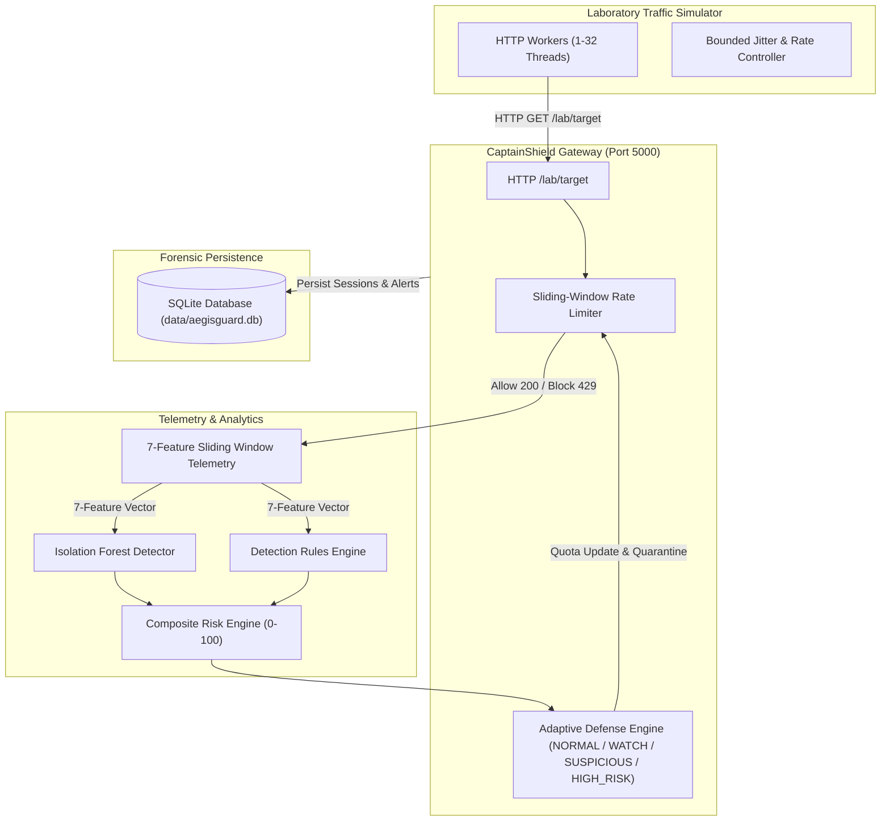

# CaptainShield — Adaptive DDoS Detection, Machine Learning & Network Defense Platform

> **Defensive Cybersecurity Laboratory & SOC Platform**  
> Standalone native desktop software featuring live laboratory HTTP traffic simulation, sliding-window 7-feature telemetry extraction, Isolation Forest ML anomaly detection, client-bound adaptive rate limiting, persistent SQLite forensics, and real-time Wireshark loopback observability.

---

## 1. Quick Start — Running CaptainShield

### Option A: Standalone Desktop Software (Recommended)
CaptainShield is packaged as a standalone Windows desktop executable with an embedded local defense gateway and hardware-accelerated WebView2 interface:
- **Direct Launch:** Double-click [`CaptainShield.exe`](file:///c:/Users/manas/Downloads/CaptainShield/CaptainShield.exe) in the root folder.
- **Batch Shortcut:** Double-click [`Run-CaptainShield.bat`](file:///c:/Users/manas/Downloads/CaptainShield/Run-CaptainShield.bat).

*No web browser, Node.js, or terminal commands required.*

### Option B: Python Desktop Launcher
```powershell
python desktop_app.py
```

### Option C: Developer Mode (Backend + Vite Dev Server)
```powershell
# Terminal 1: Backend Gateway & ML Engine
python backend/main.py

# Terminal 2: React Frontend Dev Server
cd frontend
npm run dev
```

---

## 2. Project Directory Structure

```
CaptainShield/
│
├── CaptainShield.exe               # Standalone Windows Desktop Software (Ready to Run)
├── Run-CaptainShield.bat           # Quick launcher shortcut
├── build_executable.bat            # One-click executable rebuild script
├── desktop_app.py                  # Desktop application entry point (PyWebView + Edge WebView2)
├── README.md                       # Main repository guide & documentation
├── docker-compose.yml              # Container orchestration
│
├── docs/                           # Technical & Forensic Documentation
│   ├── CAPTAINSHIELD_IMPLEMENTATION_REPORT.md # Full forensic overhaul and verification report
│   ├── CAPTAINSHIELD_FORENSIC_AUDIT.md        # Adversarial ML & architecture audit
│   ├── CAPTAINSHIELD_IMPLEMENTATION_PLAN.md   # Overhaul engineering plan
│   ├── DATA_INTEGRITY.md                      # Data provenance & schema specification
│   └── ML_PIPELINE.md                         # Isolation Forest ML pipeline documentation
│
├── backend/                        # Defensive Engine, ML, APIs & Telemetry
│   ├── main.py                     # Flask gateway & SPA static bundle server
│   ├── app/                        # Application Core
│   │   ├── api.py                  # REST API blueprint routes
│   │   ├── defense.py              # Adaptive defense & sliding-window rate limiter
│   │   ├── ml_detector.py          # Isolation Forest anomaly detector & inference
│   │   ├── soc_engine.py           # Detection rules engine & lab-safe SOAR playbooks
│   │   ├── replay.py               # Read-only detection replay & explainability engine
│   │   ├── database.py             # SQLite persistence layer (aegisguard.db)
│   │   ├── telemetry.py            # 7-feature sliding window telemetry aggregator
│   │   ├── feature_schema.py       # Strict schema definitions & vector validation
│   │   ├── simulation.py           # Bounded laboratory HTTP traffic generator
│   │   ├── search.py               # Forensic IP/session search engine
│   │   ├── redis_layer.py          # Redis stream publisher (in-memory fallback)
│   │   └── config.py               # Safety limits & path configuration
│   ├── training/                   # Machine Learning Training Pipeline
│   │   ├── dataset_loader.py       # Real dataset validator (zero synthetic fallback)
│   │   ├── train.py                # Isolation Forest training script
│   │   ├── evaluate.py             # Genuine evaluation metrics calculation
│   │   ├── model_registry.py       # Model artifact versioning under models/
│   │   ├── feature_extractor.py    # Flow-to-feature mapping
│   │   └── preprocessing.py        # RobustScaler normalization
│   ├── tools/                      # Administrative & Verification Tools
│   │   ├── generate_demo_dataset.py # Generates quarantined demo flows
│   │   ├── reset_database.py       # Resets SQLite database to clean state
│   │   └── verify_live_run.py      # Automated pipeline verification script
│   └── tests/                      # Automated Verification Test Suite
│       ├── test_overhaul_and_soc.py # SOC rules, replay, defense tests (8/8 PASS)
│       └── test_ml_integrity.py     # Real ML dataset & inference tests (9/9 PASS)
│
├── frontend/                       # Futuristic SOC User Interface (React + TypeScript)
│   ├── src/
│   │   ├── components/
│   │   │   ├── Dashboard.tsx       # Main workspace and view switcher
│   │   │   ├── HeroSection.tsx     # Landing page overview
│   │   │   ├── LiveSimulationView.tsx # Live DoS attack & SOC monitoring
│   │   │   ├── ThreatMatrixView.tsx   # Threat Matrix forensic dashboard
│   │   │   ├── DetectionRulesView.tsx # Detection Rules, SOC Cases & SOAR Playbooks
│   │   │   ├── DetectionReplayView.tsx# Read-only forensic replay & explainability
│   │   │   ├── WiresharkLabView.tsx   # Wireshark loopback walkthrough
│   │   │   ├── SettingsView.tsx    # Lab target & safety policies
│   │   │   └── CyberGlobe.tsx      # 3D WebGL network visualization
│   │   └── services/
│   │       └── api.py / api.ts     # Frontend REST client service
│   └── dist/                       # Production-compiled React SPA assets
│
├── models/                         # Persisted Machine Learning Models
│   └── isolation_forest/
│       ├── current/                # Active production model artifacts
│       │   ├── model.joblib        # Trained scikit-learn Isolation Forest
│       │   ├── preprocessor.joblib # Calibrated RobustScaler
│       │   ├── metrics.json        # Genuine evaluation metrics
│       │   └── training_metadata.json # Hash, samples, timestamp
│       └── iforest-20261008-153122/
│
├── data/                           # Data Storage & Datasets
│   ├── aegisguard.db               # SQLite database (Sessions, Rules, Cases)
│   ├── datasets/
│   │   ├── cicddos2019/            # Directory for official CIC-DDoS2019 CSVs
│   │   │   └── DATASET_MANIFEST.md # Official dataset provenance documentation
│   │   └── demo/                   # Quarantined synthetic demo fixtures
│   │       └── synthetic_demo_flows.csv
│   └── processed/                  # Preprocessed tensors
│
└── archive/                        # Archived Legacy Prototypes & Scripts
    └── v1_prototype/               # September 2026 prototype files
```

---

## 3. Defense Pipeline Architecture



---

## 4. Key Capabilities

1. **Native Desktop Software:** Packaged via PyInstaller into a standalone executable (`CaptainShield.exe`) utilizing Microsoft Edge WebView2.
2. **Real ML Pipeline:** Isolation Forest trained on genuine network flows. Zero synthetic fallbacks in production.
3. **Client-Bound Adaptive Defense:** Incoming simulated client IPs (`SIM-CLIENT-001`...) inherit elevated defense tiers or specific quarantine overrides.
4. **Detection Rules & SOC Operations:** Full rule CRUD, persisted SOC cases, analyst notes, and lab-safe SOAR playbooks.
5. **Detection Replay & Explainability:** Analysts can replay past session telemetry through current ML weights in 100% read-only audit mode.
6. **Wireshark Loopback Observability:** Real HTTP traffic observable in Wireshark on loopback port 5000.

---

## 5. Running Automated Verification Tests

To run the complete test suite:

```powershell
# Run SOC, Rules, Replay & Adaptive Defense tests
python -m unittest backend.tests.test_overhaul_and_soc

# Run ML Integrity & Dataset tests
python -m unittest backend.tests.test_ml_integrity
```
