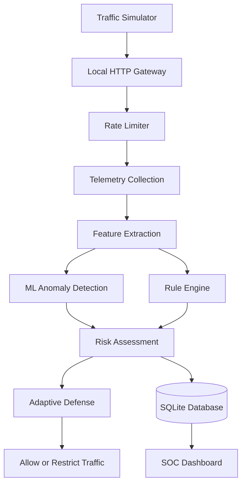
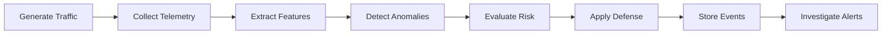

# 🛡️ CaptainShield

**Machine Learning-Based DDoS Detection and Adaptive Defense Platform**

CaptainShield is a cybersecurity project that detects abnormal network traffic using machine learning and supports defensive traffic management through a SOC-style dashboard.

## 🚀 Features

- **Traffic Simulation:** Generate controlled traffic for lab testing.
- **Anomaly Detection:** Identify unusual traffic using Isolation Forest.
- **Adaptive Defense:** Apply rate limiting and defensive responses.
- **SOC Dashboard:** Review alerts, events, and investigation cases.
- **Telemetry Analysis:** Extract features from traffic windows.
- **Event Storage:** Store investigation records using SQLite.
- **Traffic Inspection:** Analyze local traffic with Wireshark.

## 🧰 Tech Stack

| Component | Technologies |
|---|---|
| Frontend | React, TypeScript |
| Backend | Python, Flask |
| Machine Learning | scikit-learn, Isolation Forest |
| Database | SQLite |
| Telemetry | Sliding-window feature extraction |
| Network Analysis | Wireshark |
| Containers | Docker, Docker Compose |

## 🏗️ Architecture



## 🔄 Detection Workflow



1. Generate traffic in a controlled environment.
2. Collect and analyze traffic telemetry.
3. Detect anomalies using ML and detection rules.
4. Evaluate risk and apply configured defenses.
5. Store events for investigation and review.

## 📂 Project Structure

```text
CaptainShield/
├── backend/
│   ├── app/
│   ├── training/
│   ├── tools/
│   └── tests/
├── frontend/
│   └── src/
├── docker-compose.yml
├── launch_web_gui.py
├── run_aegisguard.bat
├── LICENSE
└── README.md
```

*Note: Adjust this structure to match the files in your repository.*

## ⚙️ Getting Started

### Prerequisites

- Git
- Python
- Node.js and npm
- Optional: Docker and Wireshark

### 1. Clone the repository

```bash
git clone https://github.com/manasvig-cyber/Captain-Shield.git
cd Captain-Shield
```

### 2. Set up the backend

```powershell
python -m venv .venv
.\.venv\Scripts\Activate.ps1
```

If `requirements.txt` exists, install dependencies:

```bash
pip install -r requirements.txt
```

Start the backend using the entry point documented in your project.

### 3. Set up the frontend

```bash
cd frontend
npm install
npm run dev
```

Open the local URL displayed in the terminal.

## 🧪 Testing

Run the available backend tests from the project root:

```bash
python -m unittest backend.tests.test_overhaul_and_soc
python -m unittest backend.tests.test_ml_integrity
```

## 🔐 Security Notice

Use traffic simulation only in isolated labs or on systems you are authorized to test. Do not direct simulated attack traffic at public services or third-party networks.

## 🗺️ Future Improvements

- Improve anomaly detection accuracy.
- Expand automated testing.
- Add detailed detection metrics.
- Improve alert explanations and reports.

## 🤝 Contributing

1. Fork the repository.
2. Create a feature branch.
3. Implement and test your changes.
4. Submit a pull request.

## 📄 License

Licensed under the MIT License. See [LICENSE](LICENSE) for details.

---

**CaptainShield** — Defensive security research and controlled laboratory testing.
