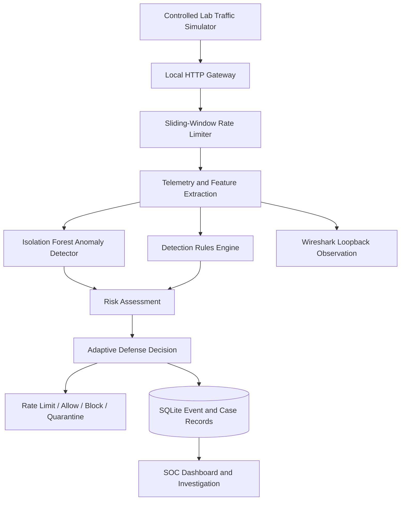

<div align="center">

# 🛡️ CaptainShield

### Adaptive DDoS Detection, Machine Learning & Network Defense Platform

**A defensive cybersecurity lab for traffic simulation, anomaly detection, adaptive rate limiting, and SOC-style investigation.**

<p>
  
  
  
  
  
</p>

[Overview](#-overview) · [Features](#-key-features) · [Architecture](#-architecture) · [Setup](#-getting-started) · [Testing](#-testing) · [License](#-license)

</div>

---

## 📌 Overview

CaptainShield is a defensive cybersecurity platform for studying **DDoS-style traffic patterns, machine-learning-based anomaly detection, and adaptive network defense** in a controlled laboratory environment.

It combines a Python backend, a React and TypeScript interface, an Isolation Forest anomaly detector, a sliding-window telemetry pipeline, and SQLite-backed records for security events and investigation. Its lab traffic simulator is intended for local, bounded testing rather than attacks against public or third-party systems.

## ✨ Key Features

- **Controlled traffic simulation** — generate bounded HTTP traffic for testing the detection and defense pipeline in a lab.
- **ML-based anomaly detection** — use an Isolation Forest model to identify unusual traffic patterns from extracted telemetry.
- **Sliding-window telemetry** — aggregate network/request behaviour into a structured feature vector for analysis.
- **Adaptive rate limiting** — apply rate limits and defensive responses based on observed traffic and risk state.
- **SOC-style investigation** — review detection rules, alerts, cases, and analyst notes through the interface.
- **Detection replay and explainability** — replay historical telemetry in read-only mode for analysis.
- **Forensic persistence** — store sessions, cases, and related records in SQLite.
- **Wireshark lab observability** — inspect local loopback HTTP traffic generated by the lab.
- **Desktop and developer workflows** — repository includes launcher scripts and a web-based development setup.

> **Safety:** Use the simulator only in the intended local lab environment or on systems for which you have explicit authorization. Do not direct test traffic at public IPs, third-party services, or production systems.

## 🧰 Technology Stack

| Layer | Technologies |
|---|---|
| Frontend | React, TypeScript |
| Backend / API | Python, Flask, REST API |
| Machine learning | scikit-learn, Isolation Forest, RobustScaler |
| Telemetry | Sliding-window feature extraction and schema validation |
| Persistence | SQLite |
| Optional stream layer | Redis with an in-memory fallback |
| Network inspection | Wireshark, loopback traffic |
| Desktop wrapper | Python desktop launcher / WebView-based interface |
| Containers | Docker Compose |
| Testing | Python `unittest` |

## 🏗️ Architecture

The diagram below shows the main logical path from lab traffic to detection, response, and persistence.



### Detection and response flow

1. The simulator generates bounded HTTP requests within the lab.
2. The local gateway receives requests and applies the current rate-limit policy.
3. Telemetry is aggregated into a sliding window and mapped to validated features.
4. The ML detector and rule engine assess the observed behaviour.
5. The risk/defense logic determines the appropriate defensive state and response.
6. Relevant session and investigation data is persisted for dashboard review and replay.

The exact response depends on the current configuration and implementation; the diagram is a high-level representation of the intended processing flow.

## 🔄 ML Pipeline

```mermaid
flowchart LR
    A["Network Flow Dataset"] --> B["Dataset Validation"]
    B --> C["Preprocessing / RobustScaler"]
    C --> D["Feature Extraction"]
    D --> E["Isolation Forest Training"]
    E --> F["Model Evaluation"]
    F --> G["Versioned Model Artifacts"]
    G --> H["Runtime Inference"]
    H --> I["Anomaly Signal"]
    I --> J["Risk and Defense Engine"]
```



The repository includes a training and evaluation workflow. Use the project's documented dataset sources and validation scripts when training or evaluating the model. Do not treat demonstration data as evidence of real-world detection accuracy.

## 🖥️ Getting Started

### Prerequisites

- Git
- Python version compatible with the project's dependencies
- Node.js and npm for frontend development
- Optional: Docker and Docker Compose
- Optional: Wireshark for inspecting local lab traffic

### 1. Clone the repository

```bash
git clone https://github.com/manasvig-cyber/Captain-Shield.git
cd Captain-Shield
```

### 2. Start the backend

From the repository root:

```bash
python -m venv .venv
```

Activate the environment on Windows PowerShell:

```powershell
.\.venv\Scripts\Activate.ps1
```

Install the dependencies using the dependency file supplied by the project. If the repository contains `requirements.txt`, run:

```bash
pip install -r requirements.txt
```

Then start the backend:

```bash
python backend/main.py
```

### 3. Start the frontend

Open a second terminal:

```bash
cd frontend
npm install
npm run dev
```

Use the local URL printed by the frontend development server.

> **Note:** The commands above describe the development workflow. Check the repository's current dependency files and launcher scripts if a command differs from your local checkout.

### Optional: Docker

A `docker-compose.yml` file is included. Review its service definitions and environment requirements before starting the stack:

```bash
docker compose up --build
```

### Optional: Desktop launcher

The repository includes desktop/launcher-related files. Follow the instructions in the current checkout for the supported desktop launch method; packaged executables may not be present in every clone or release.

## 🧪 Testing

Run the backend verification suites from the repository root:

```bash
python -m unittest backend.tests.test_overhaul_and_soc
python -m unittest backend.tests.test_ml_integrity
```

These tests cover parts of the SOC/defense workflow and ML integrity pipeline. Passing tests do not by themselves establish production readiness or detection accuracy against all DDoS patterns.

## 📂 Repository Layout

```text
Captain-Shield/
├── backend/
│   ├── app/                 # API, defense, telemetry, rules, persistence
│   ├── training/            # Dataset validation, training and evaluation
│   ├── tools/               # Verification and administrative utilities
│   └── tests/               # Backend and ML verification tests
├── frontend/
│   └── src/                 # React + TypeScript interface
├── Captain shield/          # Additional project assets or components
├── docker-compose.yml
├── launch_web_gui.py
├── run_aegisguard.bat
└── README.md
```

The tree is a high-level guide. Files and folders may change as the project evolves.

## 🔐 Security, Data, and Responsible Use

- Run traffic simulations only in an isolated lab or against explicitly authorized targets.
- Keep datasets, model artifacts, logs, and local databases free of credentials and unnecessary personal data.
- Validate the provenance and licensing of datasets before use or redistribution.
- Treat ML outputs as signals for investigation, not as conclusive proof of malicious activity.
- Review rate limits, target settings, and safety controls before running a simulation.
- Do not expose a development gateway or dashboard to an untrusted network without an appropriate security review.

## 🗺️ Roadmap

Potential areas for future improvement:

- More documented and reproducible model evaluation
- Additional traffic features and detection baselines
- Clearer false-positive and false-negative reporting
- Expanded automated tests and CI checks
- Improved analyst explanations and investigation exports
- Deployment and hardening documentation

## 🤝 Contributing

Contributions, bug reports, and documentation improvements are welcome.

1. Fork the repository.
2. Create a branch: `git checkout -b feature/your-change`.
3. Make and test your changes.
4. Commit: `git commit -m "Describe your change"`.
5. Push your branch and open a pull request.

For significant changes, open an issue first to discuss the proposal. Do not submit real credentials, sensitive traffic captures, or private datasets.

## 📷 Screenshots

Add genuine screenshots from your running application to the repository (for example, under `docs/images/`) and link them here. Suggested screenshots:

- Main dashboard
- Live lab simulation and telemetry
- Threat matrix or alert view
- Detection rules and SOC cases
- Read-only detection replay

Example once an image has been added:

```markdown

```

## 📄 License

This project is licensed under the **MIT License**. See the [`LICENSE`](LICENSE) file for details.

---

<div align="center">

**CaptainShield** · Built for defensive security research, learning, and controlled laboratory testing.

</div>
